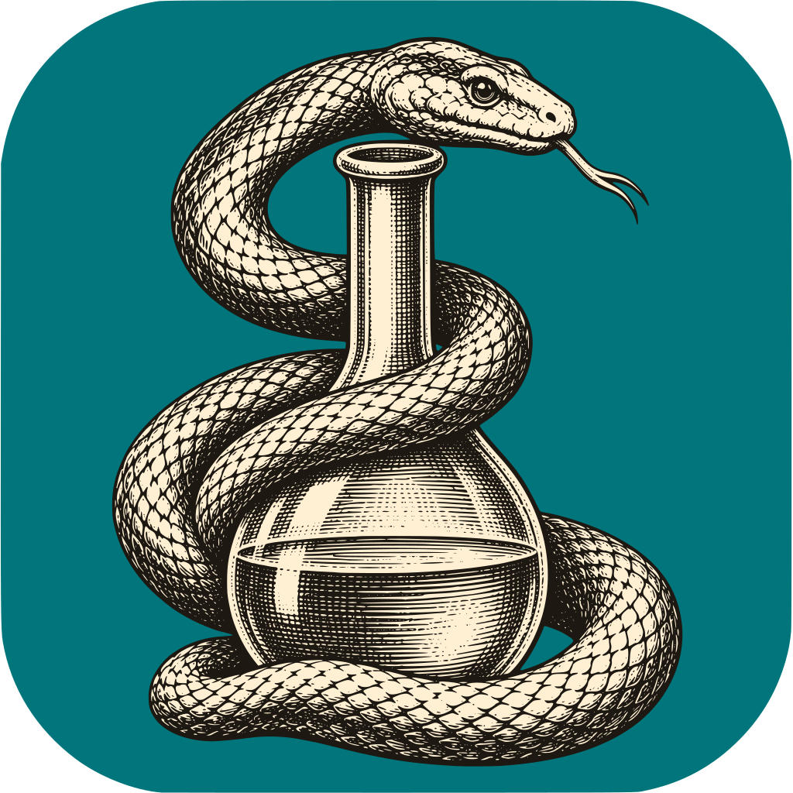
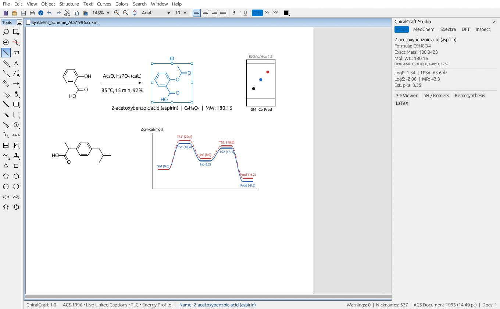
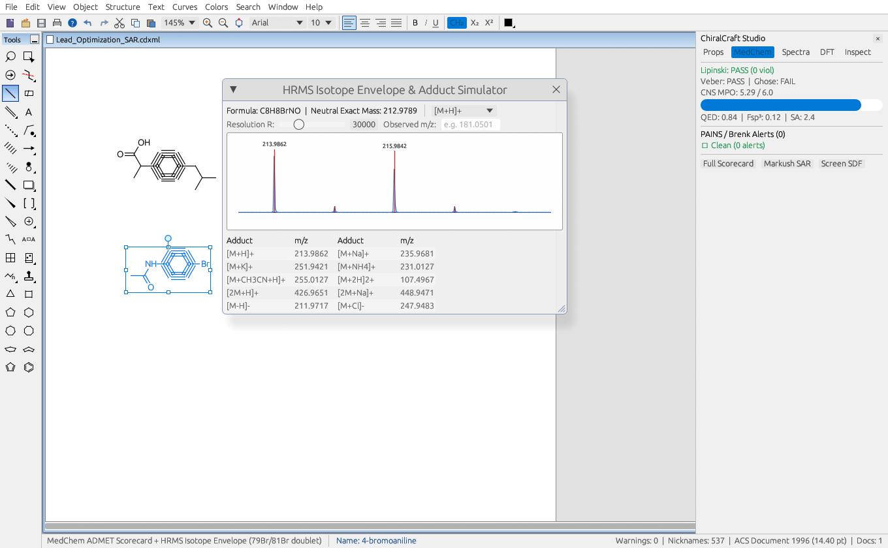
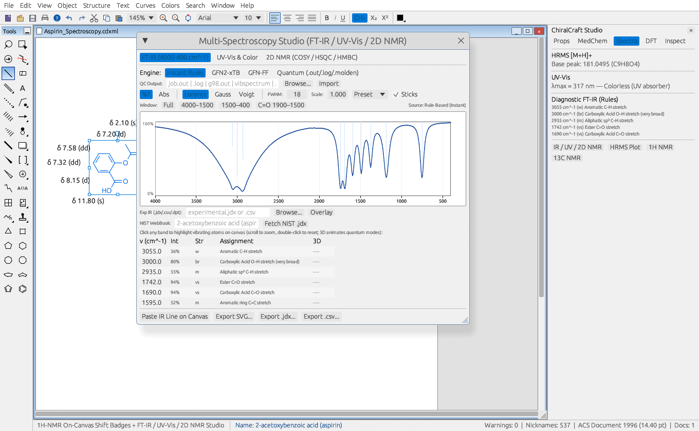
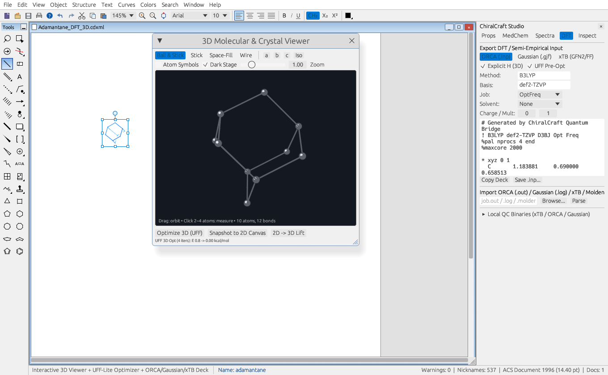
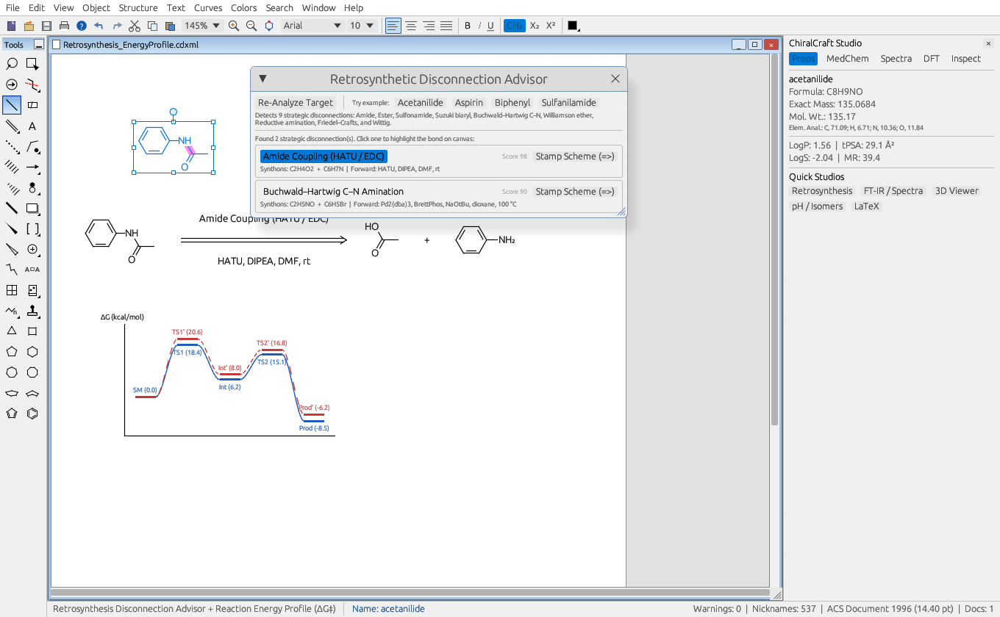
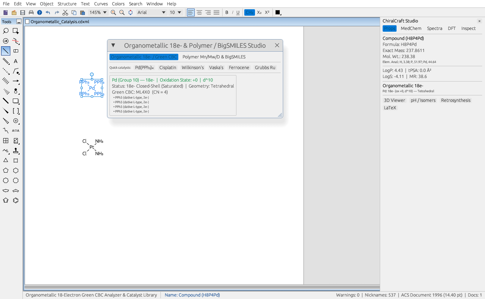
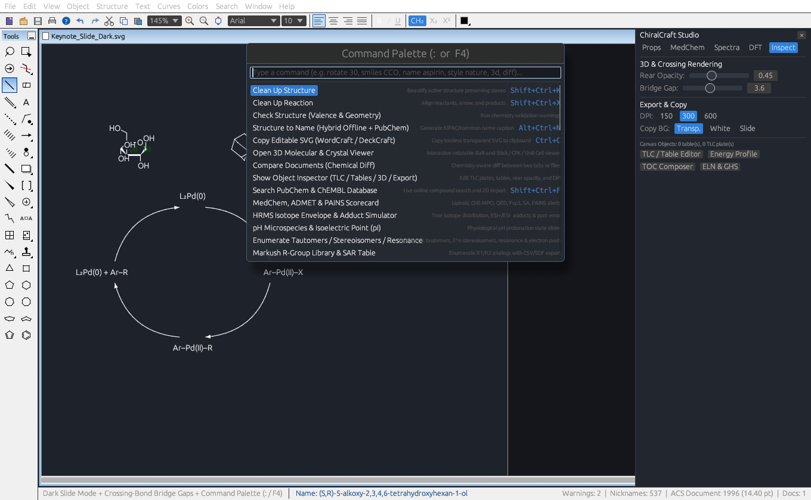

<p align="center">
  
</p>

<h1 align="center">ChiralCraft</h1>

<p align="center">
  <b>Publication-grade chemical structure drawing, spectroscopy, medicinal chemistry, 3D &amp; quantum studio — built in pure Rust.</b><br>
  IUPAC 2008 2D vector drawing, real-time cheminformatics, multi-spectroscopy, retrosynthesis, 3D UFF optimization,<br>
  lossless editable SVG/PNG/PDF publishing, and a 17-tool MCP server. Open source, native, offline-first, and yours.
</p>

<p align="center">
  <a href="https://github.com/nosidak/chiralcraft/releases/latest"></a>
  
  
  
  
  
</p>

<br>

<p align="center">
  
  <br>
  <sub>A publication-ready synthesis scheme (ACS Document 1996) with stacked arrow conditions, live linked formula/MW captions, a colored TLC plate, a dual-pathway reaction energy profile (ΔG‡), and the unified Right-Side Studio Dock.</sub>
</p>

<p align="center">
  <a href="#features">Features</a> ·
  <a href="#complete-premium-capabilities">Premium Capabilities</a> ·
  <a href="#everything-in-the-box">Everything in the Box</a> ·
  <a href="#file-formats--lossless-round-trip">Formats</a> ·
  <a href="#built-for-automation--ai-agents">CLI &amp; MCP</a> ·
  <a href="#under-the-hood">Under the Hood</a> ·
  <a href="#get-started">Get Started</a> ·
  <a href="docs/README.md">Docs</a>
</p>

<br>

<table>
  <tr>
    <td width="25%" valign="top">
      <h3>🧪 Publication-ready by design</h3>
      IUPAC 2008 rendering, 16 journal stylesheets, 53 interactive tools, 98 context-sensitive hotkeys, smart left-facing group reversal, and crossing-bond bridge gaps out of the box.
    </td>
    <td width="25%" valign="top">
      <h3>⚡ Native pure Rust</h3>
      Zero Electron, zero Python runtime, zero Java VM. Instant startup, responsive GPU-accelerated 2D/3D canvas, and a single 16 MB self-contained binary.
    </td>
    <td width="25%" valign="top">
      <h3>🗂️ 22+ lossless formats</h3>
      Native CDXML, CDX, MOL/SDF/RXN, XYZ, CIF, PDB, VASP POSCAR, JCAMP-DX, ORCA/Gaussian/xTB, LaTeX/TikZ, and lossless round-trip Editable SVG, PNG &amp; Vector PDF 1.4.
    </td>
    <td width="25%" valign="top">
      <h3>🤖 Agent-ready</h3>
      The same pure-Rust engine drives the desktop GUI, a full scientific CLI, and a zero-dependency 19-tool stdio MCP server (<code>chiralcraft --mcp</code>) for AI research agents.
    </td>
  </tr>
</table>

<br>

## Quick Start: Where to Find Key Tools

| Tool / Workflow | How to Open in GUI | Keyboard / Command Palette |
|---|---|---|
| **Retrosynthetic Disconnection Advisor** | `Structure › Retrosynthetic Disconnection Advisor...` or **Right Dock → Props → Retrosynthesis** (works even on a blank canvas with 1-click examples: *Acetanilide*, *Aspirin*, *Biphenyl*, *Sulfanilamide*) | Press `:` or `F4`, type `retro` |
| **Multi-Spectroscopy Studio (FT-IR / UV–Vis / 2D NMR)** | `Structure › Multi-Spectroscopy Studio...` or **Right Dock → Props → FT-IR / Spectra** | Press `:` or `F4`, type `ir` or `spec` |
| **¹H / ¹³C NMR & On-Canvas `δ` Badges** | `Structure › Predict 1H-NMR / 13C-NMR` or `Structure › NMR Shift Labels` | `nmr stamp` in Command Palette |
| **MedChem, ADMET & PAINS Scorecard** | `Structure › MedChem, ADMET & PAINS Scorecard...` or **Right Dock → MedChem** | Live in Right Studio Dock |
| **Interactive 3D Viewer & UFF Optimizer** | `Structure › View Active Structure in 3D` or **Right Dock → Props → 3D Viewer** | `3d` or `opt3d` in Command Palette |
| **Quantum Chemistry (ORCA / Gaussian / xTB)** | `Structure › Quantum Chemistry Bridge...` or **Right Dock → DFT** | Generate `.inp`/`.gjf`/`.xyz` or run local `xtb` |
| **Draw Structure from Name / SMILES** | `Structure › Convert Name to Structure` or `Edit › Paste Special › SMILES` | `Shift+Ctrl+N` / `Alt+Ctrl+P` |

<br>

## Features

Every screenshot below is the real ChiralCraft desktop application captured directly from its GPU framebuffer (`chiralcraft --screenshot`).

<table>
  <tr>
    <td width="50%" valign="top">
      
      <br>
      <sub>MedChem ADMET &amp; PAINS Scorecard in the studio dock alongside the live HRMS isotope envelope showing the ⁷⁹Br/⁸¹Br M / M+2 doublet and ESI+/ESI− adduct table.</sub>
      <h3>Medicinal chemistry &amp; HRMS built in</h3>
      Score every drawn structure live against Lipinski Rule of 5, Veber, Ghose, Pfizer CNS MPO (0–6), QED drug-likeness, Fsp³, Synthetic Accessibility (SA), and PAINS/Brenk reactive toxicophore filters with direct red/amber atom highlighting on the canvas.
      <br><br>
      Simulate exact natural-abundance isotopic envelopes across all 118 IUPAC elements (`Cl`, `Br`, `S`, `B`, `Si`, `Pd`, `Pt` patterns), compare observed <em>m/z</em> ppm errors, and inspect 10 ESI+/ESI− adducts without leaving the canvas.
    </td>
    <td width="50%" valign="top">
      
      <br>
      <sub>Simulated FT-IR transmittance trace (4000–400 cm⁻¹) with clickable vibrating-group assignments, on-canvas ¹H-NMR δ badges, and quick HRMS/UV–Vis readouts in the dock.</sub>
      <h3>Multi-spectroscopy studio</h3>
      Predict ¹H-NMR (400 MHz) and ¹³C-NMR (100 MHz) chemical shifts and multiplicities with clickable peak-to-atom highlighting, stamp publication `δ (ppm)` badges onto structures, and overlay experimental **JCAMP-DX (`.jdx`)** spectra directly behind predicted traces.
      <br><br>
      Switch tabs for simulated **FT-IR (`%T`)**, **UV–Vis** `λmax` with perceived solution color swatches, and interactive **2D NMR** contour plots (**COSY**, **HSQC**, **HMBC**) that highlight both coupled atoms on the canvas.
    </td>
  </tr>
  <tr>
    <td width="50%" valign="top">
      
      <br>
      <sub>UFF-lite 3D geometry optimization and interactive Ball &amp; Stick orbit viewer paired with a live ORCA B3LYP/def2-TZVP input deck in the DFT dock tab.</sub>
      <h3>Interactive 3D, crystals &amp; quantum bridge</h3>
      Lift any 2D drawing to a 3D conformer, minimize strain with the built-in pure-Rust **UFF-lite force field**, orbit in Ball &amp; Stick, Stick, Space-Filling (CPK), or Wireframe mode, click 2–4 atoms to measure **bond distances (Å)**, **angles (°)**, and **dihedrals (°)**, and snapshot any 3D angle back onto the 2D canvas with Z-depth cueing.
      <br><br>
      Import `.xyz`, `.cif`, `.pdb`, and VASP `POSCAR`/`CONTCAR` files with live crystallographic unit-cell wireframes, export ready-to-run **ORCA (`.inp`)**, **Gaussian (`.gjf`)**, and **GFN2-xTB** decks, and parse `.out`/`.log` SCF energies, HOMO–LUMO gaps, dipoles, and DFT IR modes.
    </td>
    <td width="50%" valign="top">
      
      <br>
      <sub>Strategic retrosynthetic disconnection highlighting, one-click `⇒` scheme stamping with forward reagents, and a vector reaction energy profile (ΔG‡) on the canvas.</sub>
      <h3>Retrosynthesis, Markush SAR &amp; kinetics</h3>
      Analyze targets for high-value synthetic disconnections (Amide, Ester, Suzuki, Buchwald–Hartwig, Sulfonamide, Williamson, Reductive Amination, Friedel–Crafts, Wittig) with live bond highlighting and one-click retrosynthesis scheme generation.
      <br><br>
      Enumerate `R1`/`R2` **Markush scaffolds** into sortable SAR grids (with SDF/CSV export), draw publication **Reaction Energy Profiles (`ΔG‡`)** with competing pathways, and compute Eyring rate constants (`k`, `t₁/₂`) and Boltzmann selectivity (`% ee` / `er`).
    </td>
  </tr>
  <tr>
    <td width="50%" valign="top">
      
      <br>
      <sub>Green CBC (`MLxXy`) organometallic electron counting for `Pd(PPh₃)₄` (18e⁻, d¹⁰, Tetrahedral) and Cisplatin alongside one-click catalyst library stamping.</sub>
      <h3>Organometallics, polymers &amp; ELN safety</h3>
      Count valence electrons automatically across transition-metal complexes using the **18-electron rule &amp; Green Covalent Bond Classification (`MLxXy`)** — reporting oxidation state, `dⁿ` configuration, saturation status, and predicted geometry — backed by a built-in **Organometallic Catalysts** library (`Pd(PPh₃)₄`, Cisplatin, Wilkinson's, Vaska's, Ferrocene, Grubbs Ru).
      <br><br>
      Switch tabs for **Polymer `Mn`/`Mw`/`Đ` &amp; BigSMILES**, or open the **ELN Supporting Info &amp; GHS Safety Handbook** for liquid volume calculations and one-click ACS/JOC experimental procedures.
    </td>
    <td width="50%" valign="top">
      
      <br>
      <sub>Dark UI + Dark Slide Canvas mode with crossing-bond bridge gaps, Haworth sugar projection, a 4-step Pd catalytic cycle, and the fuzzy Command Palette (<code>:</code> / <code>F4</code>).</sub>
      <h3>Dark slide mode, command palette &amp; round-trip publishing</h3>
      Switch seamlessly between **Classic Light**, **Dark UI + White Canvas**, and **Dark UI + Dark Slide Canvas** — automatically exporting crisp light-ink transparent SVGs and vector PDFs for keynote slides.
      <br><br>
      Press `:` or `F4` for the **Command Palette** (`rotate 30`, `scale 150`, `smiles CCO`, `name aspirin`, `style nature`, `theme slide`, `nmr stamp`, `3d`, `diff`, `dpi 600`), and copy/paste **lossless editable SVGs** directly into office suites like WordCraft and DeckCraft.
    </td>
  </tr>
</table>

<br>

## Complete Premium Capabilities

ChiralCraft includes an all-in-one suite of capabilities that are typically split across multiple expensive commercial drawing, spectroscopy, cheminformatics, 3D modeling, crystallographic, and electronic lab notebook packages — unified here in one free, open-source native application.

### 1. Publication-Grade 2D Drawing, Layout & Stylesheets
- **IUPAC 2008 Graphics Compliance (`GR-1`–`GR-10`)**: Automatic left-facing terminal heteroatom inversion (`HO—`, `H₂N—`, `HS—`), superscript charges & isotopes, subscript hydrogen counts, `180°` linear alkynes/nitriles, ring-interior shortened double bonds, and wedged/hashed/bold/wavy/hollow/dative stereobonds.
- **Automatic Crossing-Bond Bridge Gaps**: Automatically breaks rear bonds cleanly where a front bond crosses over (ideal for bridged cages like adamantane, norbornane, and macrocycles), with adjustable clearance radius.
- **16 Built-In Journal Stylesheets**: ACS Document 1996, Nature Research, RSC (1-col & 2-col), Wiley, JOC, Angewandte Chemie, Science of Synthesis, Phytomedicine, J. Het. Chem., J. Mol. Mod. (1-col & 2-col), Dark Mode, Presentation Slide, New A4, and Standard 30 pt.
- **Catalytic Cycles & Special Chemical Cores**: One-click circular/elliptical catalytic cycle arranger, 4-step Pd starter cycle generator, **Haworth sugar projections** (pyranose & furanose), **porphine**, **18-crown-6**, **adamantane**, **norbornane**, and modular **lab glassware & gas-line apparatus**.
- **Publication TOC & Scheme Composer**: Exact journal Graphical Abstract / TOC boundary frames (`ACS`, `Nature`, `RSC`, `Angewandte`) with live overflow detection, smart above/below arrow condition stacking, and automatic serpentine multi-step reaction scheme wrapping.
- **Interactive TLC Plate & Data Table Inspector**: Edit TLC eluent labels, origin baselines, spot `Rf` values, lane labels, custom RGB spot colors, and multi-row/column tables live on canvas and in lossless exported SVGs.
- **Smart Reverse Functional-Group Typing & Expansion**: Type left-facing reversed groups naturally (`HO`, `H2N`, `O2N`, `MeO`, `AcO`, `F3C`, `BocHN`, `HO2C`, `MeO2C`, `EtO2C`, `TBSO`, `BnO`, `NC`) and expand/contract any of **537 built-in chemical nicknames** and functional groups with full Undo/Redo.

### 2. Real-Time Cheminformatics, Stereochemistry & Structure ↔ Name
- **Full Valence & Chemistry Validation Engine**: 118-element periodic & natural-abundance isotope tables, implicit hydrogen perception, aromaticity perception (Hückel & fused systems), and live valence/charge/stereo/geometry chemical warnings with 13 toggleable warning preferences.
- **CIP & Enhanced Stereochemistry**: Automatic `(R)`/`(S)` tetrahedral stereocenters, `(E)`/`(Z)` alkene stereochemistry (with ring suppression), sulfoxide/allene/oxime/atropisomer support, and MDL/V3000 **Enhanced Stereochemistry** groups (`abs`, `or1`, `&1`).
- **Live Linked Property & Name Captions**: Attach formula, exact mass, MW, IUPAC name, or full summary captions that automatically recalculate and update in place whenever you edit the parent molecule.
- **Hybrid Offline + Online Structure ↔ Name**: Instant pure-Rust offline IUPAC naming + automatic live **PubChem** IUPAC & common drug name resolution (`Alt+Ctrl+N`), plus Name-to-Structure (`Shift+Ctrl+N`) and user-extensible name dictionaries.
- **Live PubChem & ChEMBL Search & Curated Import**: Search by name, CAS, CID, ChEMBL ID, formula, exact SMILES, 2D Tanimoto similarity, or substructure (`Shift+Ctrl+F`), inspect clinical phase & drug metadata, and import clean 2D MOL/SDF structures scaled to your active journal stylesheet.
- **Chemistry-Aware Document Diff**: Compare any two open tabs or files (`.cdxml`, `.svg`, `.png`, `.pdf`, `.mol`, `.sdf`) chemically — reporting added, removed, and modified structures, formula/mass deltas, and stereochemical changes.

### 3. Medicinal Chemistry, ADMET, PAINS & High-Resolution Mass Spectrometry
- **Live MedChem & Drug-Likeness Scorecard**: Lipinski Rule of 5 (with violation breakdown), Veber oral bioavailability, Ghose filter, **Pfizer CNS MPO (0–6)**, **QED** quantitative drug-likeness, **Fsp³** three-dimensionality, and **Synthetic Accessibility (SA, 1–10)**.
- **PAINS & Brenk Structural Alert Screening**: Real-time detection of assay-interfering and reactive toxicophore motifs with interactive red/amber atom highlighting directly on the drawing canvas.
- **Batch Virtual Screening Library Browser**: Load `.sdf`, `.smi`, or `.csv` screening libraries and filter/sort interactively by MW, LogP, CNS MPO, QED, Lipinski compliance, and PAINS alerts, then stamp hits straight to the canvas.
- **Exact HRMS Isotope Envelope & Adduct Simulator**: Full natural-abundance isotopic convolution across all 118 elements, resolution slider (`R = 5,000–100,000`), Gaussian profile + centroid stick display, 10 ESI+/ESI− adducts (`[M+H]+`, `[M+Na]+`, `[M+K]+`, `[M+NH4]+`, `[M+CH3CN+H]+`, `[M+2H]2+`, `[2M+H]+`, `[2M+Na]+`, `[M-H]-`, `[M+Cl]-`), and observed `m/z` ppm-error calculator.

### 4. Multi-Spectroscopy Suite (¹H/¹³C/2D NMR, FT-IR, UV–Vis & Experimental Overlays)
- **Interactive ¹H-NMR & ¹³C-NMR Predictor**: Reversed ppm-axis Lorentzian spectrum viewer with multiplicities, coupling constants, proton counts, clickable peak ↔ atom canvas highlighting, and one-click on-canvas `δ (ppm)` badge stamping.
- **Experimental JCAMP-DX (`.jdx`) Overlay**: Load real spectrometer `.jdx`/`.dx` files (`XYDATA` & `PEAK TABLE`) directly behind predicted ¹H/¹³C NMR spectra for instant visual comparison.
- **FT-IR Transmittance Simulator (`4000–400 cm⁻¹`)**: Simulated `%T` spectrum with clickable diagnostic band assignments that highlight the vibrating functional group directly on the canvas and paste formatted ACS IR strings.
- **UV–Vis Chromophore Estimator & 2D NMR Contour Plots**: Woodward–Fieser/conjugated-system `λmax`, molar absorptivity `ε`, perceived solution color swatch, and interactive **COSY**, **HSQC**, and **HMBC** 2D correlation maps highlighting both coupled atoms.

### 5. Synthesis Planning, Markush SAR, Reaction Kinetics & ELN Supporting Info
- **Retrosynthetic Disconnection Advisor**: Scores strategic disconnections (Amide, Ester, Suzuki, Buchwald–Hartwig, Sulfonamide, Williamson, Reductive Amination, Friedel–Crafts, Wittig), highlights the target bond in dashed red on the canvas, and stamps complete `⇒` retrosynthesis schemes with forward reagents.
- **Markush R-Group Enumerator & SAR Grid**: Define `R1`/`R2` attachment libraries on any core scaffold, enumerate full combinatorial series into a sortable MedChem/ADMET SAR grid, stamp grids onto the canvas, or export to `.sdf`/`.csv`.
- **pH Microspecies, Tautomers, Stereoisomers & Resonance**: Interactive physiological pH (`1.0–14.0`) protonation state viewer with isoelectric point (`pI`), prototropic tautomer enumerator, `2ⁿ` stereoisomer generator, ranked resonance contributors, and curved-arrow electron-pushing mechanistic stepper.
- **Reaction Energy Profiles (`ΔG‡`) & Eyring/Boltzmann Kinetics**: Build publication vector free-energy diagrams with optional competing Pathway B curves, automatic Eyring rate constant `k` & half-life `t₁/₂` at any temperature, and Boltzmann selectivity (`% ee` / `er` from `ΔΔG‡`).
- **Reaction Stoichiometry Grid, Atom Mapping & ELN Supporting Info**: Live mmol/mass/equivalents stoichiometry table with CSV export, reaction auto-numbering, automatic reaction atom mapping, a searchable **GHS Lab Safety & Solvent/Reagent Handbook** (with automatic liquid volume mL calculator), and one-click ACS/JOC Supporting Information experimental + NMR/IR/HRMS characterization text generation.

### 6. Organometallic 18-Electron, Biopolymer & Polymer Chemistry
- **Organometallic 18-Electron & Green CBC (`MLxXy`) Engine**: Computes oxidation state, `dⁿ` electron count, neutral/anionic ligand breakdown, saturation status (`18e⁻`, `16e⁻ d⁸ square planar`, unsaturated/hypervalent), and predicted geometry across d-block transition metals, paired with a built-in catalyst library.
- **HELM / FASTA Biopolymers & Gel Electrophoresis**: Build peptide, DNA, and RNA chains from HELM/FASTA sequences or monomer palettes, lay out serpentine biopolymer grids, and stamp editable **Gel Electrophoresis Plates (GEP)**.
- **Polymer `Mn`/`Mw`/`Đ` & BigSMILES Studio**: Repeat-unit stoichiometry, dispersity (`Đ = Mw/Mn`), degree of polymerization, and **BigSMILES** notation builder.

### 7. Interactive 3D Molecular Mechanics, Crystallography & Quantum Chemistry Bridge
- **Interactive 3D Viewer & UFF-Lite Force-Field Optimizer**: Drag-to-orbit Ball & Stick, Stick, Space-Filling (CPK), and Wireframe modes, 2D→3D conformer lift, pure-Rust UFF-lite energy minimization, click-to-measure **distances (Å)**, **angles (°)**, and **dihedrals (°)**, and **Snapshot to 2D Canvas** with configurable 3D rear-atom opacity.
- **Crystallographic Unit-Cell Support**: Native `.xyz`, `.cif`, `.pdb`, and VASP `POSCAR`/`CONTCAR` import with automatic unit-cell wireframe rendering and `a`/`b`/`c`/`Iso` crystallographic axis snap buttons.
- **Computational Chemistry Bridge (ORCA / Gaussian / xTB)**: Export ready-to-run ORCA `.inp`, Gaussian `.gjf`, and `GFN2-xTB` decks (Opt+Freq, Single Point, TD-DFT, GIAO NMR, implicit solvents, charge/multiplicity), and parse `.out`/`.log` outputs for SCF energy, HOMO–LUMO gap, dipole moment, DFT IR modes, and optimized 3D geometries.

### 8. Lossless Round-Trip Publishing, LaTeX, CLI & AI Agent MCP Server
- **Lossless Editable SVG, PNG & Native Vector PDF 1.4**: Every exported SVG (`<chiralcraft:document>`), PNG (`tEXt` chunk `ChiralCraftDocument`), and PDF (`%CHIRALCRAFT_CDXML_B64:`) embeds the full lossless chemical graph — including Energy Profiles, Tables, and TLC plates — for true reopen-and-edit round-tripping.
- **Wayland/X11 Editable SVG Clipboard & Host-App Round-Trip (`--edit-svg`)**: `Ctrl+C` pushes transparent `image/svg+xml` to the OS clipboard for direct pasting into WordCraft/DeckCraft/office suites; double-click editing via `chiralcraft --edit-svg <file.svg>` atomically writes updates back on save/close.
- **Native LaTeX (`\chemfig` / `\schemestart`) & TikZ Vector Export**: Export single molecules (including disconnected salts & multivalent charges) or full multi-step reaction schemes directly to compilable LaTeX and `tikzpicture` code.
- **Zero-Dependency 17-Tool MCP Server & Batch CLI**: Script every analysis, conversion, diff, NMR/IR/MedChem/HRMS/retrosynthesis/18e⁻/quantum calculation, or editable SVG render from the terminal or directly from AI agents over JSON-RPC 2.0 stdio.

<br>

## Everything in the Box

<table>
  <tr>
    <td width="33%" valign="top">
      <h4>🧰 53 interactive tools</h4>
      Marquee · Freehand Lasso · 3D Structure Perspective · Mass Fragmentation · Eraser · Solid, Double, Triple, Multiple, Quadruple, Bold, Wedge, Hash-Wedge, Hollow-Wedge, Dashed, Hashed, Wavy &amp; Dative Bonds · Acyclic Chain · Cyclopropane through Cyclooctane · Benzene · Cyclopentadiene · Chair Conformers (L/R) · Text &amp; Inline Atom Labels · Reaction, Equilibrium, Retrosynthetic, No-Go &amp; Curved Electron-Pushing Arrows · Bezier Pen Curves · s/p/d Orbitals · Rectangles, Ovals &amp; Lines · Square, Round &amp; Curly Brackets · +, −, Radical &amp; Lone-Pair Symbols · Reaction Atom Mapper · Interactive Tables · TLC Plates · Template Stamps
    </td>
    <td width="33%" valign="top">
      <h4>📚 11 libraries · 16 stylesheets · 537 nicknames</h4>
      Clean-room built-in libraries: Aromatics &amp; Heterocycles · Amino Acids · Carbohydrates · Nucleobases · Pharmaceuticals · Functional Groups · Steroids &amp; Polycycles · Haworth &amp; Macrocycles · Lab Glassware &amp; Apparatus · BioGraphics &amp; Lab Shapes · Organometallic Catalysts.
      <br><br>
      16 journal stylesheets (ACS 1996, Nature, RSC, Wiley, JOC, Angewandte, Slide, Dark Mode, etc.) and 537 mutable chemical nicknames with collision prompts &amp; Expand/Contract Label.
    </td>
    <td width="33%" valign="top">
      <h4>🎛️ Studio dock &amp; command palette</h4>
      Unified Right-Side Tabbed Studio Dock (<code>Props</code>, <code>MedChem</code>, <code>Spectra</code>, <code>DFT</code>, <code>Inspect</code>) with persistent settings in <code>~/.config/chiralcraft/config.json</code>.
      <br><br>
      Fuzzy Command Palette (<code>:</code> / <code>F4</code>), 98 context-sensitive atom/bond hotkeys, MDI multi-document tabs, <code>File › Open Recent</code>, OS drag-and-drop, <code>Ctrl+Scroll</code> zoom-to-cursor, and middle-mouse pan.
    </td>
  </tr>
  <tr>
    <td width="33%" valign="top">
      <h4>🗂️ 22+ file formats</h4>
      <b>Native &amp; Chemical:</b> CDXML, CDX, MOL (V2000 &amp; V3000), SDF, RXN (V2000 &amp; V3000), SMILES (`.smi`), SLN, InChI/InChIKey, CML, CT, TGF, SKC, HELM, FASTA.<br>
      <b>3D, Crystal &amp; Quantum:</b> XYZ, CIF, PDB, VASP POSCAR/CONTCAR, ORCA (`.inp`/`.out`), Gaussian (`.gjf`/`.log`), GFN2-xTB, 3MF.<br>
      <b>Spectra &amp; Vector Media:</b> JCAMP-DX (`.jdx`), Editable SVG, Editable PNG, Editable Vector PDF 1.4, EPS, EMF, LaTeX (`.tex`/TikZ).
    </td>
    <td width="33%" valign="top">
      <h4>🎨 Three independent themes</h4>
      Switch freely between <b>Classic Light</b>, <b>Dark UI + White Canvas</b>, and <b>Dark UI + Dark Slide Canvas</b>.
      <br><br>
      Export preferences for PNG DPI (150/300/600), SVG padding, transparent/white/dark-slide copy backgrounds, ring fill &amp; highlight colors, CPK color-by-element, and 3D rear-bond opacity.
    </td>
    <td width="33%" valign="top">
      <h4>♻️ Non-destructive editing</h4>
      Full multi-step transaction Undo/Redo stack (`Ctrl+Z` / `Shift+Ctrl+Z`), Repeat Last Action (`Ctrl+Y`), Revert to Saved, Align &amp; Distribute, Flip/Rotate preserving `(R)`/`(S)` stereochemistry, Group/Ungroup, and Clean Up Structure / Reaction / Biopolymer.
    </td>
  </tr>
</table>

<br>

## File Formats & Lossless Round-Trip

Every SVG, PNG, and PDF exported by ChiralCraft carries the complete lossless CDXML document — including reaction energy profiles, data tables, and TLC metadata — so published figures stay editable forever.

```xml
<svg xmlns="http://www.w3.org/2000/svg"
     xmlns:chiralcraft="https://chiralcraft.dev/ns/1.0"
     data-chiralcraft-version="1.0" ...>
  <metadata>
    <chiralcraft:document format="cdxml" encoding="base64">...</chiralcraft:document>
  </metadata>
  <!-- publication-grade IUPAC vector paths & text -->
</svg>
```

See [docs/FORMATS.md](docs/FORMATS.md) for the complete read/write capability matrix and [docs/WORDCRAFT_DECKCRAFT_INTEGRATION.md](docs/WORDCRAFT_DECKCRAFT_INTEGRATION.md) for the host-application `--edit-svg` round-trip specification.

<br>

## Built for Automation & AI Agents

Every scientific CLI command accepts **either any supported file path or a raw SMILES string** directly:

```bash
# Chemical analysis, MedChem, HRMS, spectroscopy, retrosynthesis, 18e- & LaTeX
chiralcraft analyze "CC(=O)Oc1ccccc1C(=O)O"
chiralcraft medchem aspirin.cdxml
chiralcraft hrms "Brc1ccccc1" --adduct "[M+H]+"
chiralcraft nmr "CC(=O)Oc1ccccc1C(=O)O" --13c
chiralcraft ir aspirin.mol
chiralcraft retro "CC(=O)Nc1ccccc1"
chiralcraft 18e "[Pt](Cl)(Cl)(N)N"
chiralcraft export-tex scheme.cdxml
chiralcraft screen library.sdf

# Quantum decks, crystal/format conversion, diff & lossless media verification
chiralcraft quantum-in molecule.mol --engine orca
chiralcraft quantum-parse job.out
chiralcraft convert crystal.cif diagram.pdf
chiralcraft diff old.svg new.svg
chiralcraft inspect-media figure.png

# Host-app round-trip editing & deterministic GPU screenshots
chiralcraft --edit-svg /tmp/embedded-diagram.svg
chiralcraft --screenshot hero docs/images/chiralcraft-hero.png

# Zero-dependency stdio JSON-RPC 2.0 MCP server (17 tools)
chiralcraft --mcp
```

Full CLI flags and all 17 MCP tool definitions are documented in [docs/CLI_AND_MCP.md](docs/CLI_AND_MCP.md).

<br>

## Under the Hood

ChiralCraft is structured as a clean, layered 5-crate Rust workspace with zero external chemistry runtime dependencies:

| Crate | Responsibility |
|---|---|
| `chiralcraft-tables` | 118-element periodic table, IUPAC isotopic masses & abundances, valence rules, 537 built-in chemical nicknames |
| `chiralcraft-chem` | Valence & aromaticity perception, CIP `(R)/(S)/(E)/(Z)` stereochemistry, physicochemical properties, ¹H/¹³C/2D NMR, FT-IR, UV–Vis, MedChem/ADMET/PAINS, HRMS isotope convolution, pH/tautomers/isomers/resonance, 18e⁻ Green CBC, polymers, UFF-lite 3D force field, IUPAC Structure ↔ Name |
| `chiralcraft-formats` | CDX binary & CDXML XML parsers/writers, MOL/SDF/RXN (V2000/V3000), SMILES, SLN, InChI, CML, CT, TGF, SKC, XYZ, CIF, PDB, VASP POSCAR/CONTCAR, JCAMP-DX, ORCA/Gaussian/xTB, HELM/FASTA/3MF, Editable PNG & Native Vector PDF 1.4 |
| `chiralcraft-doc` | Interactive document scene graph, Undo/Redo transaction log, 16 journal stylesheets, 11 template libraries, 2D layout cleanup, crossing-bond clearance, Markush SAR, retrosynthesis, reaction energy profiles, ELN SI & GHS safety, LaTeX/TikZ, Editable SVG, chemical diff |
| `chiralcraft-app` | Native `eframe`/`egui` desktop GUI, 53 tools, 98 hotkeys, Command Palette, Right-Side Studio Dock, Interactive 3D Viewer, live PubChem/ChEMBL client, Wayland/X11 clipboard bridge, CLI, and 17-tool MCP server |

See [docs/ARCHITECTURE.md](docs/ARCHITECTURE.md) for full architectural details.

<br>

## Get Started

### Download Prebuilt Packages

Prebuilt native installers and portable archives for every platform are published on the [**GitHub Releases**](https://github.com/nosidak/chiralcraft/releases/latest) page with verified `SHA256SUMS.txt` checksums:

| Platform | Architecture | Available Packages |
|---|---|---|
| **Linux** | `x86_64` &amp; `aarch64` | `.AppImage`, `.deb` (Debian/Ubuntu), `.rpm` (Fedora/RHEL/openSUSE), `.pkg.tar.zst` (Arch Linux), `.tar.gz` |
| **macOS** | Universal (Apple Silicon + Intel) | `.dmg` (`ChiralCraft.app`), `.zip`, plus standalone `aarch64.tar.gz` &amp; `x86_64.tar.gz` |
| **Windows** | `x64` &amp; `ARM64` | `.msi` (WiX installer), `-setup.exe` (Inno Setup), `-portable.zip` |
| **FreeBSD** | `x86_64` | `.tar.gz` |

### Build & Run from Source

Requires Rust `1.78+` (standard Cargo toolchain; no external C/Python/Java chemistry libraries needed):

```bash
git clone https://github.com/nosidak/chiralcraft.git
cd chiralcraft
cargo build -p chiralcraft-app --release
./scripts/install-linux-desktop.sh   # installs ~/.local/bin/chiralcraft, desktop launcher, icon & MIME types
chiralcraft
```

### Run the Test Suite

```bash
cargo test --workspace
```

The workspace ships with **76 unit, integration, format round-trip, MCP protocol, and headless full-frame `egui` GUI tests** covering all 53 tools, all 11 template libraries, all 29 floating windows/studios, and all 40 dialogs.

<br>

## Documentation

| Guide | What It Covers |
|---|---|
| [docs/README.md](docs/README.md) | Documentation hub & quick orientation |
| [docs/FEATURES.md](docs/FEATURES.md) | Complete deep-dive catalog of all GUI, cheminformatics, spectroscopy, 3D & quantum features |
| [docs/FORMATS.md](docs/FORMATS.md) | Full 22+ chemical, crystallographic, quantum, spectral & editable vector/raster format matrix |
| [docs/CLI_AND_MCP.md](docs/CLI_AND_MCP.md) | Every CLI subcommand, flag, and all 17 MCP JSON-RPC 2.0 tool schemas |
| [docs/SHORTCUTS_AND_UI.md](docs/SHORTCUTS_AND_UI.md) | Keyboard shortcuts, 98 context-sensitive hotkeys, smart reversed typing & Command Palette guide |
| [docs/WORDCRAFT_DECKCRAFT_INTEGRATION.md](docs/WORDCRAFT_DECKCRAFT_INTEGRATION.md) | Editable SVG clipboard & `--edit-svg` round-trip protocol for office suites |
| [docs/ARCHITECTURE.md](docs/ARCHITECTURE.md) | 5-crate architecture, scene graph, transaction model, and contributor guide |
| [CHANGELOG.md](CHANGELOG.md) | Release history |

<br>

## License

ChiralCraft is licensed under the **GNU Affero General Public License v3.0 or later** (`AGPL-3.0-or-later`) — see [LICENSE](LICENSE).

Copyright (c) 2026 [nosidak](https://github.com/nosidak). Diagrams, spectra, input decks, and exported files created *with* ChiralCraft belong solely to their authors and are not restricted by this license.
